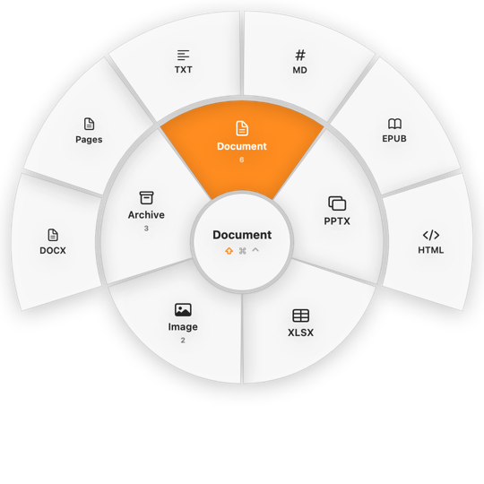
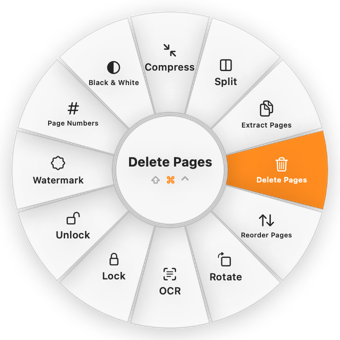
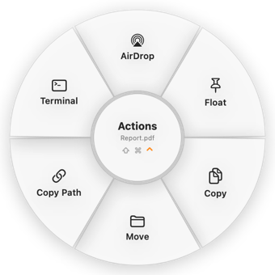

# DynamicFileConverter

A drag-and-drop file converter for the Mac menu bar. Start dragging any file, tap a key, and drop it on a wheel to convert it, run a tool on it, or send it somewhere. Everything runs locally, and nothing is uploaded.

The idea comes from [Tangerine](https://tangerineformac.com), which only runs on Apple silicon. DynamicFileConverter is an independent, open-source take on the same idea that also runs on **Intel Macs with macOS 13 Ventura**.

> Not affiliated with, endorsed by, or connected to Tangerine or its developers.

<p align="center">
  
  
</p>

## Contents

- [Features](#features)
- [Requirements](#requirements)
- [Install](#install)
- [Usage](#usage)
- [Command-line tool](#command-line-tool)
- [How it works](#how-it-works)
- [Development](#development)
- [Known limitations](#known-limitations)
- [Uninstall](#uninstall)
- [License](#license)

## Features

### Convert (⇧ Shift)

| From | To |
|---|---|
| **Images:** JPG, PNG, WebP, HEIC, TIFF, AVIF, BMP, GIF, SVG | JPG, PNG, WebP, HEIC, TIFF, AVIF, BMP, GIF, PDF |
| **Video:** MP4, MOV, MKV, WebM, AVI, WMV, M4V, GIF | MP4, MOV, MKV, WebM, AVI, WMV, GIF, plus the audio formats |
| **Audio:** MP3, M4A, WAV, FLAC, OGG, Opus, AIFF, WMA, AAC | MP3, M4A, WAV, FLAC, OGG, Opus, AIFF, WMA |
| **PDF** | DOCX, Pages, PPTX, XLSX, JPG, PNG (every page, 300 DPI), TXT, Markdown, EPUB, HTML |
| **Documents:** DOCX, DOC, ODT, Pages, Markdown, TXT, EPUB, HTML, RTF, RTFD, text clippings | DOCX, Pages, Markdown, TXT, EPUB, HTML, RTF, ODT, PDF |
| **Slides:** PPTX, PPT, ODP, Keynote | PDF, JPG, PNG, PPTX, Keynote, ODP |
| **Spreadsheets:** XLSX, XLS, ODS, CSV, TSV, Numbers | XLSX, ODS, CSV, TSV, PDF, Numbers |
| **Subtitles:** SRT, VTT | SRT, VTT, TXT |
| **Archives:** any file or folder; ZIP, TAR, GZ, TAR.GZ, RAR, 7Z | ZIP, TAR, GZIP, or extract |

### Tools (⌘ Command)

| For | Tools |
|---|---|
| **Images** | Compress, Resize, Crop (aspect ratio presets), Rotate, Flip, Black & White, Strip Metadata |
| **Video** | Compress, Trim, Remove Audio, Extract Audio, Change Speed, Make GIF, Extract Frames, Normalize Volume, Resize, Rotate, Crop |
| **Audio** | Compress, Trim, Change Speed, Normalize Volume |
| **PDF** | Compress, Split, Extract Pages, Delete Pages, Reorder Pages, Rotate, OCR (make scanned PDFs searchable), Lock, Unlock, Watermark, Page Numbers, Black & White |
| **Several files** | Merge into PDF (PDFs and images), Merge Videos, Merge Audio, Zip Together |

If a tool has settings, such as quality, page ranges or a password, a small form opens after you drop the file. It remembers your last choices, but never passwords.

### Actions (⌃ Control)



- **AirDrop:** send the file to a nearby device.
- **Float:** pin the file to a small always-on-top shelf so you can drag it into another app later.
- **Copy:** put the file on the clipboard.
- **Move:** move it to a recent folder or one you choose.
- **Copy Path:** copy the file's full path.
- **Terminal:** open Terminal in the file's folder.

Actions work on folders and mixed selections too.

<br clear="right">

## Requirements

- macOS 13 Ventura or later. Developed and tested on an Intel Mac.
- Xcode 15 or later, to build from source.
- [Homebrew](https://brew.sh), for the helper programs below.

Some conversions use free helper programs. Anything missing shows up greyed out in the wheel, with a note saying what to install. Settings → Helpers shows what is installed and has a button to install each missing helper.

| Helper | Used for | Installed by |
|---|---|---|
| ffmpeg | All audio and video | `brew install ffmpeg` |
| Ghostscript | PDF Compress, PDF Black & White | `brew install ghostscript` |
| Tesseract | PDF OCR | `brew install tesseract` (other languages: `brew install tesseract-lang`) |
| cwebp, avifenc | Writing WebP and AVIF | `brew install webp libavif` |
| pandoc | Document conversions | `scripts/install-helpers.sh` (downloads the official binary) |
| LibreOffice | Office formats to and from PDF, slides, spreadsheets | `scripts/install-helpers.sh` |
| Python PDF tools | PDF to DOCX, PPTX, XLSX | `scripts/install-helpers.sh` (a private virtualenv with pdf2docx, python-pptx, pdfplumber, openpyxl) |
| Pages, Keynote, Numbers | Converting to and from iWork formats | Mac App Store (free) |

Images, PDF rendering and text, subtitles, ZIP/TAR/GZIP and RAR/7z extraction use only what is built into macOS.

## Install

```bash
git clone https://github.com/mtalazzar/DynamicFileConverter.git
cd DynamicFileConverter
brew install ffmpeg ghostscript tesseract webp libavif
scripts/install-helpers.sh
scripts/build-app.sh
```

`build-app.sh` does the following:
1. Builds a release version.
2. Puts together `DynamicFileConverter.app` with its icon.
3. Signs the app ad-hoc.
4. Copies it to `/Applications`.
5. Launches it.

Look for the ◎ icon in the menu bar. If you only want the app bundle in `build/`, without installing it, run `scripts/build-app.sh --no-install`.

> On macOS 13, Homebrew often has no ready-made downloads, so it may try to compile pandoc or Python packages from source, which can take hours. `install-helpers.sh` avoids that by using prebuilt downloads only.

## Usage

1. Start dragging one or more files in Finder or on the Desktop.
2. While still dragging, press **⇧** for Convert, **⌘** for Tools or **⌃** for Actions. Press another of these keys to switch wheels.
3. Drop the files on a slice. Hovering over a category opens its choices in an outer ring.
4. To cancel, drop anywhere else or press Esc.

There are also other ways to open the wheel:

| Way | How |
|---|---|
| Keyboard | Select files in Finder and press **⌥⌘C**. Use the arrow keys to move, Return to choose, Tab to switch wheels and Esc to close. |
| Services | Right-click files in Finder → Services → **Convert with DynamicFileConverter** |
| Open With | Right-click → Open With → **DynamicFileConverter** |
| Menu bar | ◎ → **Open Files…** |

New files are saved **next to the original**, for example `report.docx` next to `report.pdf`. If that name is taken, the app uses `report (1).docx` instead. Originals are never modified or overwritten. Results with many files, such as PDF pages as images or Split, go into a folder.

Progress appears in the top-right corner. From there you can cancel a job, see why it failed, or click **Show** to reveal the result in Finder.

**Settings** (◎ → Settings…):
- Change the keys for each wheel.
- Save results to a fixed folder instead of next to the original.
- Reveal results in Finder automatically.
- Turn the ⌥⌘C shortcut or the drag wheel on and off.
- Open the app at login.

**Permissions:** the drag wheel needs no special permission. macOS asks once to let the app control **Finder** (for ⌥⌘C) and **Pages, Keynote, Numbers** (for iWork conversions).

## Command-line tool

The same engine is available as `dfc`. It is built next to the app and bundled at `DynamicFileConverter.app/Contents/MacOS/dfc`.

```bash
dfc list report.pdf                                       # what can be done with this file
dfc convert report.pdf --to docx                          # convert
dfc convert *.heic --to jpg --out ~/Desktop/jpgs          # several files, custom output folder
dfc run tool.pdf.compress report.pdf quality=Smallest     # run a tool with options
dfc run tool.merge.pdf a.pdf b.pdf scan.png               # merge
dfc run                                                   # list every operation id
dfc helpers                                               # which helpers are installed
```

## How it works

```
Sources/
  ConverterCore/          Conversion engine (no UI), shared by the app, the CLI and the tests
    Model/                FileKind (format detection), FileOp, Engine, OperationRegistry, OutputNamer
    Helpers/              Helper (finds external programs), ProcessRunner (async processes, cancellation, progress)
    Backends/             Image, AV (ffmpeg), PDF, Document (pandoc), Office (LibreOffice / iWork), Subtitle, Archive
    Tools/                Image, AV, PDF and merge tools
  DynamicFileConverter/   Menu bar app (AppKit + SwiftUI)
    Drag/                 DragMonitor (detects file drags anywhere), hotkey, Finder selection, Services
    Wheel/                The radial menu: model, geometry, view, floating panel
    Jobs/                 Background job runner and progress panel
    Options/              Settings form for tools
    Actions/              AirDrop, Float shelf, Copy, Move, Copy Path, Terminal
    Settings/             Preferences and the Settings window
  dfc/                    Command-line front end
```

- **Detecting a drag anywhere on screen:**
  - A global mouse-down monitor, backed up by a light 30 Hz poll while the button is held, notes the system drag pasteboard's change count.
  - Once that count changes and the pasteboard holds file URLs, a file drag is in progress.
  - Pressing a mapped modifier key at that point opens the wheel: a transparent, non-activating panel under the cursor.
  - Each slice is a drop target.
  - None of this needs Accessibility permission.
- **Operations:** every conversion or tool is a `FileOp`. Each one has:
  - the file kinds it accepts,
  - the helpers it needs,
  - optional settings,
  - an async `perform` that writes into a private temp folder.

  `Engine` runs it, reports progress, supports cancelling, and moves results next to the original only when the job succeeded.

### Adding a conversion

Add a `FileOp` to one of the backends in `Sources/ConverterCore/Backends` or `Tools`. If it's a new backend, register it in `OperationRegistry.all`. The wheel, the CLI and the test suite pick it up automatically.

## Development

```bash
swift build                 # debug build of everything
swift test                  # full test suite
scripts/build-app.sh        # release app bundle, installed to /Applications
```

The test suite generates sample files of every kind it can (images, a multi-page PDF, video, audio, documents, spreadsheets, slides, subtitles, archives). It runs **every available operation** on them and checks that each output exists and opens: images decode, PDFs have pages, media has a duration, Office files are valid containers. Operations whose helper isn't installed are skipped, and so are iWork conversions, which would trigger permission prompts. A full run takes about 6 minutes.

## Known limitations

- **Not checked by hand yet:** these haven't been exercised end to end:
  - the drag-and-press gesture in Finder,
  - Pages/Keynote/Numbers conversions,
  - AirDrop,
  - the Services menu.

  Please open an issue if something doesn't behave.
- **Tested only on one setup:** an Intel Mac running macOS 13. It should build on Apple silicon and newer macOS, but that hasn't been tested.
- **Ad-hoc signing:** the app is signed ad-hoc, so macOS may ask for the Finder/iWork permissions again after each rebuild. The first launch of a downloaded copy also needs right-click → Open.
- **Conversion quality depends on the source:**
  - PDF → Office conversions depend on the PDF. Scanned PDFs need OCR first.
  - PDF → PPTX puts each page on a slide as an image, with the page text in the speaker notes.
- **PDF redrawing:** Watermark and Page Numbers redraw the pages, so links and form fields in the PDF are not kept.

## Uninstall

```bash
rm -rf /Applications/DynamicFileConverter.app
rm -rf ~/Library/Application\ Support/DynamicFileConverter
defaults delete io.github.mtalazzar.DynamicFileConverter
```

## License

[MIT](LICENSE)
